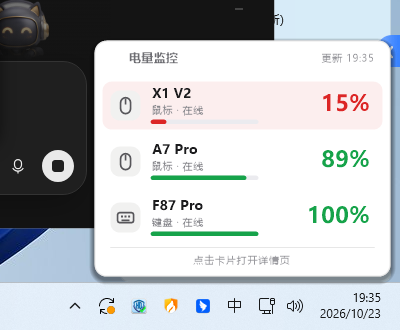

# BatteryMonitor

Windows 外设电量常驻监视器 —— 纯 Node.js 实现，支持多品牌无线外设的实时电量查询、托盘常驻、低电量提醒与历史曲线。

当前实测支持的设备：

| 设备 | 连接 | 状态 | 协议方案 |
|---|---|---|---|
| MCHOSE 迈从 A7 Pro（鼠标） | 2.4G | ✅ 已真机验证 | Realtek 方案，feature 0x11 + 取反编码 |
| AULA 狼蛛 F87（键盘） | 2.4G | ✅ 已真机验证 | Compx 方案，report 0x13 推送帧 |
| ATK X1 V2 / X1 Pro / F1 / A9 / VXE R1（鼠标） | 2.4G | 协议已按公开实测表重写，待真机确认 | Output Report 0x08（Nordic 54L15 64B / 52840 17B 双变体） |

## 功能

- **托盘图标显示最低电量设备**：图标只画"电量最低的那台"的大号数字（绿=正常/红=低于阈值/蓝=充电中/灰=离线），一眼看到最该充电的设备；16px/32px 双尺寸图标，任务栏下清晰不糊
- **悬停弹出电量卡片**：鼠标移到托盘图标上，弹出圆角卡片——每台设备的图形、名称、状态、进度条与百分比；低电量行红色高亮，点击卡片打开详情页
- **多设备并行查询**：每台设备独立协议引擎，插上自动识别，拔掉自动消失
- **右键菜单**：实时读数、开机自启开关、打开状态页、立即刷新
- **本地状态页**（`http://127.0.0.1:8787`）：每设备独立卡片、电量环、按真实时间轴的历史曲线
- **低电量提醒**：阈值 1~99 自由设置，低于阈值弹 Windows 通知
- **自适应轮询**：设备齐全时 60s 慢轮询，有设备离线时 12s 快速探测，上线即识别
- **每设备校准**：读数与设备显示有偏差时可在页面单独微调
- **极低占用**：无 Electron，Node 单进程（卡片跑在同一进程内，零新进程；实测空闲 CPU ≈ 0.4%，内存 ~67MB）



## 安装

到 [Releases](https://github.com/Orrick-oss/BatteryMonitor/releases) 下载安装包 `BatteryMonitor-Setup-x.y.z.exe`，双击运行：

1. 选择安装位置（默认 `%LOCALAPPDATA%\Programs\BatteryMonitor`，只装当前用户，无需管理员权限；也可以装到其他磁盘）
2. 勾选是否创建桌面快捷方式、是否开机自动启动
3. 点「安装」，完成后程序自动在后台运行，托盘区出现电量图标

安装后的程序目录：

```
BatteryMonitor\
  BatteryMonitor.exe   主程序
  Uninstall.exe        卸载程序
  install.json         安装信息（版本、安装时间）
  app\                 程序本体：协议引擎、状态页、依赖
  app\config.json      用户配置（阈值、校准偏移、端口）
  app\data\            电量历史与运行日志
```

托盘图标显示电量最低设备的百分比，鼠标悬停弹出电量卡片，点击卡片或托盘菜单打开状态页；右键菜单还可切换开机自启、打开程序目录、立即刷新。Win11 首次启动时图标可能落在 `^` 溢出区，程序会自动把它提升为常显。

升级新版本：直接运行新版安装包覆盖安装，配置与电量历史会保留。

## 卸载

任选一种方式：

- 开始菜单 → `BatteryMonitor` → 「卸载 BatteryMonitor」
- `设置 → 应用 → 已安装的应用 → BatteryMonitor → 卸载`
- 直接运行安装目录里的 `Uninstall.exe`

卸载会先停止正在运行的程序，再删除程序文件、开始菜单与桌面快捷方式，并清除「设置 → 应用」里的条目；默认连电量历史一起删除，卸载页可勾选「保留电量历史与设置」。

无人值守安装 / 卸载（脚本用）：

```bash
BatteryMonitor-Setup-1.0.7.exe --silent --dir=D:\Programs\BatteryMonitor
"Uninstall.exe" --silent --keep-data
```

## 构建

```bash
node scripts/build-exe.js 1.0.7        # 参数为版本号
# 产物:
#   dist/BatteryMonitor-Setup-1.0.7.exe   安装包（对外发布）
#   dist/BatteryMonitor.exe               主程序（安装目录内运行的那一个）
```

发行版用 Node 官方 SEA（Single Executable Application）把 Node 运行时与程序文件打成一个自包含二进制，安装时释放到安装目录（原生模块 koffi / node-hid / 托盘组件必须从真实磁盘路径加载，无法直接在内存中运行）。同一份二进制按文件名与运行位置切换角色：从下载目录双击时进入安装向导，安装目录内双击即启动主程序，`Uninstall.exe` 进入卸载向导。

## 源码运行

```bash
cd app
npm install          # node-hid + systray2 + koffi
node daemon.js       # 启动服务 + 托盘
node launch.js       # 或: 已在运行则只打开状态页
```

## 设备探测工具

协议适配/排查用的真机工具：

```bash
node probe.js        # 枚举本机全部 HID 设备
node atktest.js      # ATK 协议真机探测（逐接口 × 双协议变体，打印原始收发帧）
node aulatest.js     # AULA/Compx 协议真机探测
```

## 协议实现说明

- **MCHOSE（Realtek）**：VID 0x5253（备选 0x3837），usagePage 0xFF01/0xFF0B，SetFeature `[0x11][cmd^0xFF][0xFF填充]`（21 字节），身份命令 0x06，响应含 VID/电量/充电标志；首次写入为热身，需重试。
- **AULA（Compx）**：VID 0x3554 & PID 0xFA09（与 F99 Pro 接收器同方案），厂商接口 usagePage 0xFF02/0x0002，20 字节帧，校验和 = 前 19 字节之和；写会话帧 `13 05 01` 后读推送 `13 0A`：`[6]=电量%`，`[7] bit0x10=充电中`。注意 3554 为 Compx 共用号段，判据必须带 usagePage+usage。
- **ATK / VXE / VGN（Nordic）**：VID 0x373B（VXE/VGN 另用 0x3554，需排除狼蛛 PID 0xFA09）。**接收器没有 Feature Report**，必须写 Output Report 再读 Input Report（早期用 `sendFeatureReport` 导致「接收器在线但无应答」）。两种已知变体：
  - `Nordic 54L15`：usagePage 0xFF05，64 字节，请求 `08 7D 72 02 00 01 07 01`；应答校验 `0x72` 后第 5 字节 `0x07`，电量在 `0x72` 之后第 6 字节
  - `Nordic 52840`：usagePage 0xFF02，17 字节，请求 `08 04 00×14 49`（末字节 `(0x55-Σ)&0xFF`）；电量在第 6 字节，第 7 字节非 0 = 有线/充电
  - 探测顺序：先按 usagePage 精确匹配的接口试 54L15，再试 52840；命中后记住「接口+变体」，后续只走快路径；未命中则 30s 冷却，避免空转

协议细节参考了以下开源项目（仅本地对照研究，未随仓库分发）：

- [2.4G-battery-viewer](https://github.com/yszyszysz233/2.4G-battery-viewer)（ATK/VXE 双协议实测表：usagePage、帧长、电量偏移）
- [2.4G-battery-viewer](https://github.com/yszyszysz233/2.4G-battery-viewer)（ATK/VXE 双协议实测表：usagePage、帧长、电量偏移）
- [FerrisPulse 灵脉](https://github.com/Ferris-echo/FerrisPulse)（Beken/ATK 协议）
- [vigil-watt](https://github.com/evren-oct/vigil-watt)（AULA/迈从插件协议；托盘贴片图标样式亦参考其设计）
- [offline-mchose](https://github.com/Rapou7/offline-mchose)（迈从 legacy 协议文档）

## 已知限制

- F87 休眠时接收器读不到电量，页面显示「休眠」，按任意键唤醒即恢复
- 键盘固件电量为分档粗报（90~100% 都可能报 100）
- ATK 设备休眠时不回帧：状态页会显示「接收器在线但无应答」，动一下鼠标即可
- ATK 若仍读不到，点状态页的 **「ATK 诊断」** 按钮（或源码运行 `node atktest.js`），把输出发我——诊断会逐接口打印写入结果与每一帧原始回报
